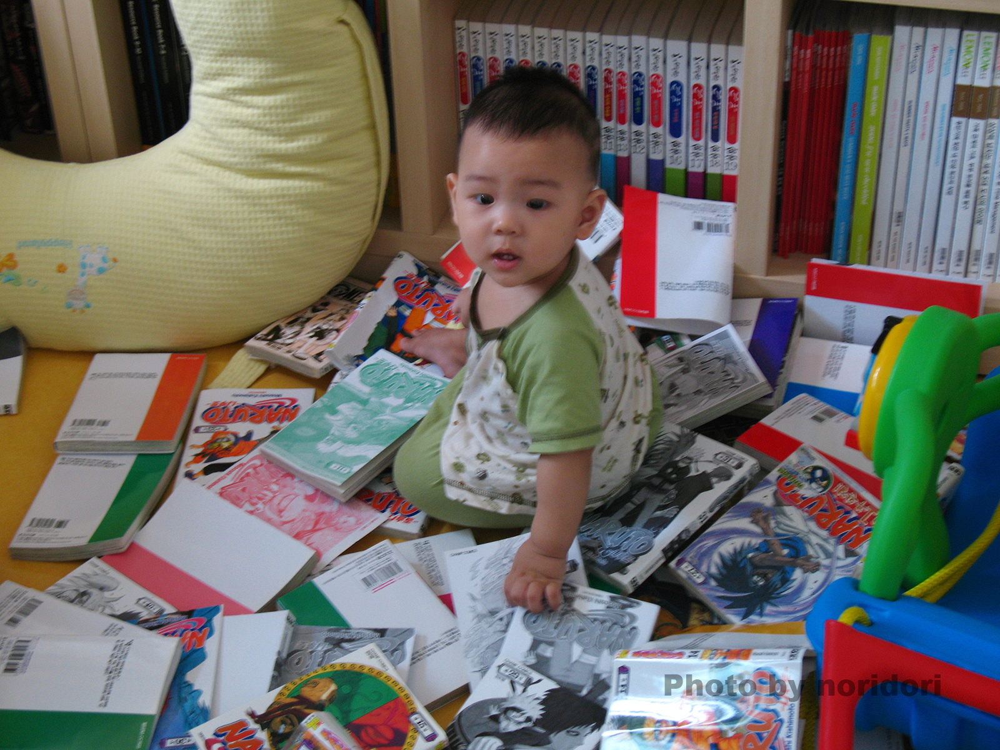

## 오늘 체크

* 컨디션: 4/5
* 운동: X

## 오늘 한 줄

먹고 놀고 자고

## 오늘의 콘텐츠

나루토 4~12권

오랜만에 정주행하니 재밌다. 시험기간에만 느낄 수 있는 공부 안하고 놀기의 재미. 나중가면 이런 것들도 그리며 살겠지.

만화책들을 펼쳐보니 4쇄에서 2쇄까지... 나보다 나이가 많은 만화책 형님들이시다. 몇몇 만화책은 커버가 살짝씩 찢어져 있거나 구겨져 있어 아버지에게 물어봤더니, 내가 돌 지났을 즈음에 날마다 책장에 만화책을 뽑고 산을 만들어 놨다더라.

사진에서만 볼 수 있었던 나의 어린시절을 만질 수 있는 물건으로 느끼게 되니 감회가 새로웠다. 어린시절과 맞닿은 듯한 그런 요상한 기분.

## 오늘 한 일

* 학교: X
* 프로젝트: X
* 루틴: X

## 잘한 것 하나

헌 헌터헌터 만화책 버리기, 오래전 삼촌에게 선물받았지만 너무 헤져버렸는걸. 상태 좋은 몇권빼고는 전부 폐기처분.

## 아쉬운 것 하나 → 내일은 이렇게

공부 좀 시작합시다

## 내일 가장 중요한 한 가지

공업수학 2주차 끝내기
