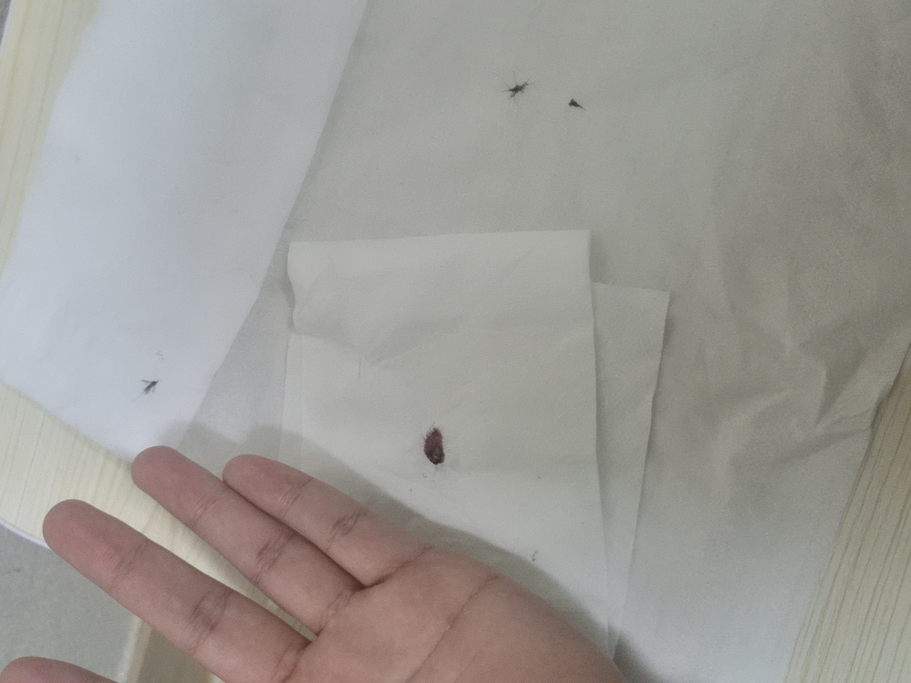
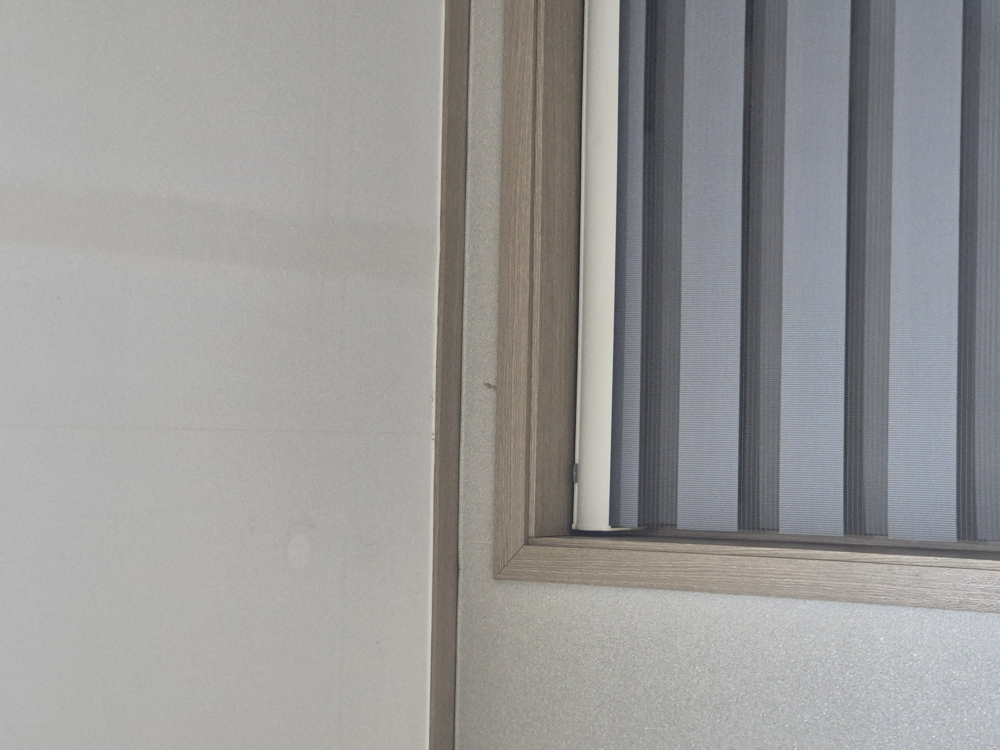

10월 초... 남정네 둘의 자취방에 모기가 모습을 드러내기 시작했다.

날마다 약 6마리정도를 사냥하며 하루하루를 보내던중. 

어느날 종건급 모기가 출현했다.

> 여기서 종건급 모기란, 그것의 크기와 속도가 다른 모기에 비해 압도적이며, 모기 사냥을 성공했을때 그것의 복부에서 터져나오는 피의 양이 넘쳐흐르는... 말 그대로 종자부터가 다른 모기를 말한다.

첨부 사진을 바탕으로 그때 당시를 재현해 보자면, 10월 14일 그 날도 다른 어느날과 같이 우리는 모기 사냥을 하고 있었다.

어디서 출현하는지 찾아도 봤지만 도저히 그것들의 발생을 발견하지 못하고, 몬스터 자연 스폰설을 주장하고 있을때 쯤 그것이 나타나게 된다.

그것은 비행 능력이 출중하여 모기 사냥꾼인 우리들을 농락하듯 곡예를 펼쳤고, 육중한 몸집에 어울리지 않는 재빠른 속도를 자랑하며 좁은 자취방을 활공했다.

종건급 모기임을 단번에 알아차린 우리는 그것의 사냥을 멈추고 다른 잔바리 모기들을 소탕하고 있었다.

그것의 출현으로부터 30분쯤 뒤에 우리는 창가 위에 종건급 모기가 휴식을 취하고 있는 것을 포착하게 된다.

하지만 창가 위라는 고난이도 사냥지대에 머무는 종건급 모기는 섣불리 사냥을 시도할 수 없었다.

창가 위는 우선 점프를 하지 않으면 닿지 않는 거리에 더해 평면적이지 않은 벽 구조로 모기 사냥에 적합하지 않은 위치였다.

동거중인 모기 사냥꾼이 주로 사용하는 사냥 기법은 휴지를 손에 두른 뒤 모기가 눈치채지 못하도록 한쪽 손을 벽에 천천히 접근시켜 한순간 벽과 밀착해 모기를 잡아내는 것.

위치에 맞게 전략을 수정하여...

처음 그것의 시체를 목격했을 때 터져나오는 혈흔의 양에 놀라..
